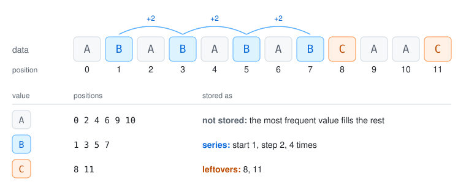
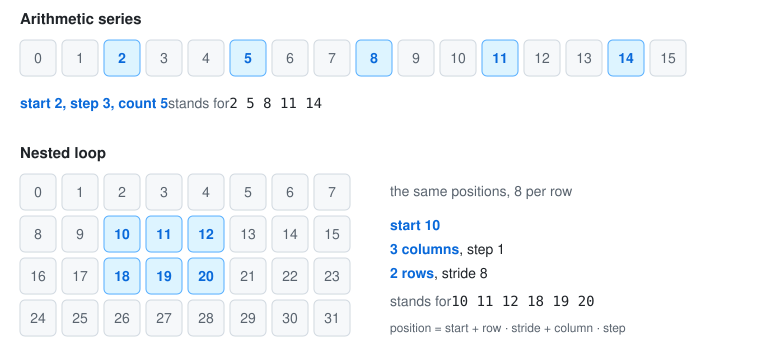
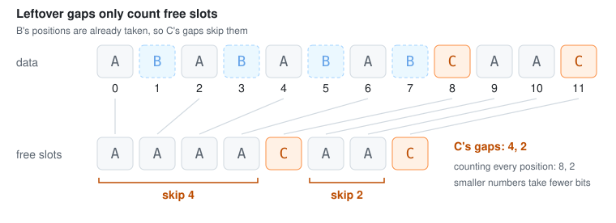
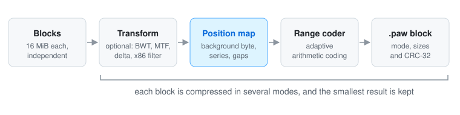
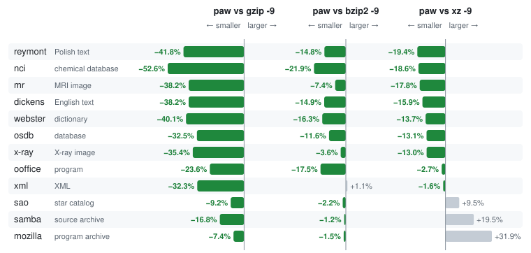

# How pawzip works

Most compressors look for repeated strings. pawzip looks at the data the other way around:
for each byte value, it records the positions where that value appears, and then looks for
patterns in those positions.

This page goes through the steps one at a time. The byte-level details are in the
[format specification](../spec/FORMAT.md).

## 1. Position map

Every byte value gets the sorted list of positions where it occurs. In the example above,
`B` is at 1, 3, 5 and 7, and `C` is at 8 and 11. These lists are all it takes to put the
data back together.

## 2. Background byte

The most frequent byte value is never stored. Once every other value is in place, it fills
the positions that are still empty. In the example that is `A`, so its 6 positions cost
nothing.

## 3. Series

Positions that follow a pattern are replaced by a few numbers. pawzip knows two patterns:

- an arithmetic series: start, step and count, such as every third position;
- a nested loop, a series of series: start, steps and counts for the columns and the rows,
  such as a rectangle in an image or a column in a table.

Series are chosen greedily, and only when they actually save space. Their shapes are
remembered, so a series that repeats a recent shape (the same rectangle somewhere else)
only stores its start.

## 4. Leftovers

The positions no series covers are stored as gaps from one position to the next. Gaps only
count free slots: positions already taken by the byte values stored before are skipped,
since they can't hold this one, which keeps the numbers small. The gaps are then compressed
with adaptive arithmetic coding (a range coder), which learns which gap sizes are common.

## 5. Modes

The data is cut into blocks (16 MiB by default), and each block is compressed on its own,
in several ways, keeping the smallest result. A block can be:

- stored as it is, for data that doesn't compress;
- mapped directly;
- mapped after a reversible transform: a Burrows–Wheeler transform with or without
  move-to-front (good for text), a delta filter (good for smooth images and signals), both
  of these, or an x86 call filter followed by the Burrows–Wheeler transform (good for
  executables).

The delta and x86 filters are only tried when the data looks suitable, and data that is
already compressed (JPEG, ZIP, video) is recognized from a sample and stored at once. Every
block carries a CRC-32 of its original bytes, so a damaged file is detected instead of being
decoded into garbage.

## Standard building blocks

The position map, background byte, series and free-slot gaps are this project's own
approach. Around them it uses well-known techniques:

- the Burrows–Wheeler transform (Burrows and Wheeler, 1994), the reshaping step used by
  bzip2, optionally followed by move-to-front
- adaptive range coding, the byte-wise form of arithmetic coding (Martin, 1979) used by LZMA
  and 7-Zip
- delta filtering, as used by PNG and many audio formats
- the x86 call filter ("E8/E9" address translation) for executables, as in 7-Zip's BCJ and
  xz's x86 filter
- LEB128 varints and CRC-32 for the container

## Benchmark

The [Silesia corpus](https://sun.aei.polsl.pl//~sdeor/index.php?page=silesia) is a standard
compression benchmark: 12 files, 212 MB of text, databases, executables, images and XML.
Each file is compressed separately. How paw's output compares with each tool's:

The compressed sizes, as a percentage of the original (lower is better), with the smallest in
bold:

| file | | size | gzip -9 | bzip2 -9 | xz -9 | paw |
|------|-|-----:|--------:|---------:|------:|----:|
| dickens | English text | 10.2 MB | 37.82% | 27.47% | 27.77% | **23.36%** |
| mozilla | program archive | 51.2 MB | 37.18% | 34.98% | **26.11%** | 34.45% |
| mr | MRI image | 10.0 MB | 36.72% | 24.48% | 27.58% | **22.68%** |
| nci | chemical database | 33.6 MB | 8.91% | 5.40% | 5.18% | **4.22%** |
| ooffice | program (DLL) | 6.2 MB | 50.27% | 46.53% | 39.45% | **38.39%** |
| osdb | database | 10.1 MB | 36.42% | 27.79% | 28.26% | **24.57%** |
| reymont | Polish text | 6.6 MB | 27.51% | 18.80% | 19.87% | **16.02%** |
| samba | source code archive | 21.6 MB | 25.01% | 21.06% | **17.42%** | 20.81% |
| sao | star catalog | 7.3 MB | 73.44% | 68.13% | **60.88%** | 66.65% |
| webster | dictionary | 41.5 MB | 29.12% | 20.85% | 20.23% | **17.46%** |
| x-ray | X-ray image | 8.5 MB | 71.33% | 47.81% | 52.98% | **46.10%** |
| xml | XML files | 5.3 MB | 12.33% | **8.25%** | 8.48% | 8.34% |

The whole corpus, with speeds:

|          |  size | compression | decompression |
|----------|------:|------------:|--------------:|
| gzip -9  | 31.9% |     10 MB/s |      240 MB/s |
| bzip2 -9 | 25.7% |     11 MB/s |       25 MB/s |
| paw      | 23.8% |    1.7 MB/s |       18 MB/s |
| xz -9    | 23.0% |    1.9 MB/s |       62 MB/s |

paw gives the smallest result on 8 of the 12 files, and is smaller than xz on 9 of them. xz
is smaller in total, mostly because of `mozilla` and `samba` (tar archives of programs and of
source code), which make up a third of the corpus. Speeds were measured on one core of the same
desktop PC for all four, with paw 1.0.0 at its default settings and the others through
Python's gzip, bz2 and lzma modules. paw tries its modes in parallel, so with four cores
available it compresses at about 3.5 MB/s.

## The format

Version 1 of the `.paw` format is frozen: every file written today will decode to the same
bytes with every later version. The complete byte-level specification is
[spec/FORMAT.md](../spec/FORMAT.md), so anyone can write their own decoder, and the test
vectors in [spec/vectors/](../spec/vectors/) check it: files in every mode, valid files the
reference encoder never writes, and one invalid file per validation rule.
